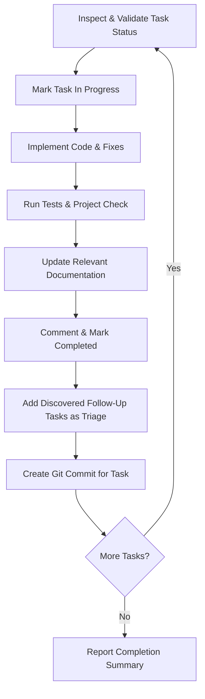

# Execute Tasks Workflow Skill

This skill defines the standardized procedure for executing a specific set of tasks sequentially with strict status validation, documentation updates, follow-up tracking, and per-task commits.

Tasks are managed with Open Tasks via the project wrapper `./otw` (see the `task-management` skill). Tasks may be referenced by 6-character short ID, UUID, or title.

---

## 1. Task Status Validation & Confirmation

Before starting execution on any given task, inspect its status using `./otw task show <ID>`:

- **Valid Statuses to Work On**:
  - `planned` (Ready for implementation)
  - `in_progress` (Work currently active)

- **Invalid / Ambiguous Statuses**:
  - `triage`: Requirements, prioritization, or technical approach unconfirmed.
  - `blocked`: Task is waiting on external dependencies or decisions.
  - `completed`: Task is already finished.
  - `closed`: Task was archived or cancelled.

> [!WARNING]
> **Status Check Rule**: If any requested task is in an invalid status (`triage`, `blocked`, `completed`, or `closed`), you **must stop, report the task ID and its current status to the user, explain why it is not ready for implementation, and ask for explicit confirmation** before proceeding with that task.

---

## 2. Step-by-Step Task Execution Loop

Process each validated task **strictly one at a time** in the requested order:



### Step A: Mark In Progress
```bash
./otw task status <ID> in_progress
```

### Step B: Implement Requirements
1. Read the task using `./otw task show <ID>`.
2. Inspect the relevant source files in `src/ot/` and implement the requested changes, adhering to the ADRs in `docs/design/adrs/`.
3. If partial implementation is required or edge cases emerge, record notes with `./otw task comment <ID> "..."`.

### Step C: Verify & Test
Run the test suite and project integrity check to ensure no regressions:
```bash
PYTHONPATH=src python3 -m unittest discover -s tests
./otw check
```
For changes affecting packaging or releases, also run:
```bash
./scripts/build-release --version 0.0.0-dev
```

### Step D: Update Documentation
Check if the changes affect:
- [README.md](../../../README.md)
- Design specifications or ADRs in `docs/design/`
- The web portal in `web/` (`index.html`, `install.sh`)

Update the corresponding files accordingly.

### Step E: Mark Task Completed
```bash
./otw task comment <ID> "Implementation notes: <summary>. Follow-up logged in <ID>."
./otw task status <ID> completed
```

### Step F: Record Newly Discovered Tasks
If any new bugs, edge cases, refactor opportunities, or follow-ups are discovered, log them immediately in `triage` status:
```bash
./otw task create \
  --title "Follow-up: <Descriptive Title>" \
  --type <feature|bug|chore|spike> \
  --status triage \
  --overview "Discovered during work on <ID>." \
  --no-edit
```

### Step G: Create Git Commit
Create a dedicated Git commit for the completed task, including its `.ot/tasks/` changes:
```bash
git add <modified-files> .ot/
git commit -m "<type>(open-tasks): <concise summary> (<ID>)"
```
*(At least one commit must be made per completed task before moving to the next task).*
